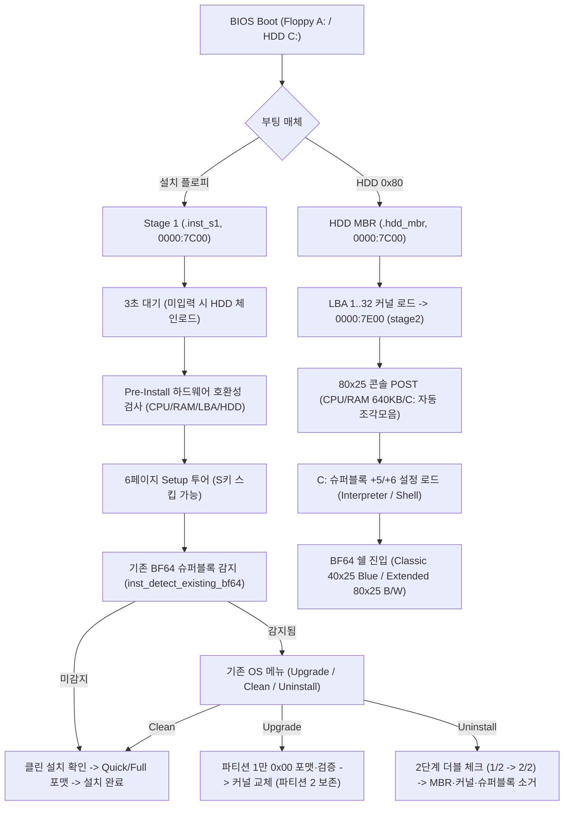
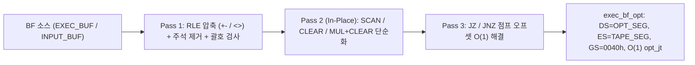

# BF64 v1.3 Technical Reference

> [!NOTE]
> 이 문서는 16-bit x86 Real Mode 베어메탈 운영체제 **BF64 v1.3**([bf64inst.asm](file:///home/antigravity/bf64inst.asm)) 및 공식 `bf64exec` 예제 애플리케이션 **BF64 Calculator**([bf64calc.asm](file:///home/antigravity/bf64calc.asm))의 내부 구조, 메모리 맵, 파일시스템 규격, 듀얼 Brainfuck 실행 엔진, TUI 유틸리티 및 외부 실행 디스크(`bf64exec`) 인터페이스를 정의하는 기술 명세서입니다.

---

## 1. 시스템 개요 및 최소 사양

**BF64 v1.3**은 외부 라이브러리나 C 런타임 없이 순수 NASM 16-bit x86 어셈블리로 작성된 독립형 운영체제입니다. 1.44 MB 부팅 플로피 이미지(`bf64inst.img`) 단일 파일 안에 **부트로더, 하드웨어 진단, XP 스타일 설치/업그레이드/제거기, HDD MBR, 16 KB 커널**이 모두 포함됩니다.

| 항목 | 사양 |
|---|---|
| 아키텍처 | x86 16-bit Real Mode (80386 이상 필수 — 32비트 연산, `FS`/`GS` 세그먼트, `movzx`, `imul`/`idiv` 사용) |
| 최소 RAM | 컨벤셔널 RAM 128 KB 이상 (부팅 POST에서 최대 640 KB까지 전수 검사) |
| 디스크 I/O | HDD: BIOS INT 13h LBA Extensions (`AH=41h/42h/43h/48h`), Floppy: CHS 자동 변환 (`AH=02h/03h/08h`) |
| 비디오 출력 | Direct VGA 텍스트 메모리(`0xB800:0000`) + BIOS INT 10h (`40x25` Classic / `80x25` Extended & TUI) |
| 커널 크기 | **16,384 Bytes (32 Sectors)** — HDD 파티션 1(`LBA 1..32`)에 상주 |
| 실행 엔진 | **Classic 1:1 VM**(기본) + **32 KB In-Place IR 최적화 VM**(3-Pass 컴파일러, $O(1)$ 점프 테이블) |
| 파일시스템 | **BF64FS v2** (고정 16 KB 슬롯 방식, HDD 최대 ~1.0 GB / 65,535슬롯, 1.44 MB 플로피 89슬롯) |
| 외부 실행 규격 | **`bf64exec`** (LBA 0 시그니처 기반 독립 부팅·실행 미디어 규격) |

---

## 2. 부팅 · 설치 · 실행 아키텍처

### 2.1 설치 플로피 이미지 구조 (`bf64inst.img`, 1,474,560 Bytes)

| 섹션 | LBA 범위 | 크기 | 로드 주소(설치 시) | 역할 |
|---|---|---|---|---|
| `.inst_s1` | `0` | 512 B (1섹터) | `0000:7C00` | 8086-Safe Multi-Track CHS 로더 (`bf64exec` 헤더 포함, [`inst_stage1`](file:///home/antigravity/bf64inst.asm#L27)) |
| `.inst_s2` | `1 ~ 30` | 15,360 B (30섹터) | `0000:7E00` | 하드웨어 진단 + XP 스타일 설치·업그레이드·제거기 |
| `.hdd_mbr` | `31` | 512 B (1섹터) | `0000:BA00` | HDD 설치용 LBA MBR 템플릿 ([`mbr_start`](file:///home/antigravity/bf64inst.asm#L2845)) |
| `.hdd_os` | `32 ~ 63` | 16,384 B (32섹터) | `0000:BC00` | BF64 v1.3 커널 본체 ([`stage2`](file:///home/antigravity/bf64inst.asm#L2964)) |
| `.pad` | `64 ~ 2879` | 1,441,792 B | — | 1.44 MB (2,880섹터) 표준 플로피 규격 0x00 패딩 |

### 2.2 전체 부트 및 설치 흐름



---

## 3. 16-bit Real Mode 메모리 맵

### 3.1 OS 런타임 메모리 배치 (HDD 부팅 후)

| 세그먼트:오프셋 | 물리 주소 | 크기 | 심볼 / 용도 |
|---|---|---|---|
| `0000:0000 - 04FF` | `0x00000 - 0x004FF` | 1.25 KB | IVT (인터럽트 벡터) 및 BIOS Data Area (`0040:001A/001C` 키보드 링 버퍼) |
| `0000:0500 - 05FF` | `0x00500 - 0x005FF` | 256 B | `INPUT_BUF` — 명령줄 입력 버퍼 (최대 240자) |
| `0000:0600 - 07FF` | `0x00600 - 0x007FF` | 512 B | `DIR_BUF` — 슈퍼블록 / 디렉토리 섹터 캐시 (1섹터) |
| `0000:0800 - 77FF` | `0x00800 - 0x77FF` | 28 KB | `EXEC_BUF` — 평탄화된 BF 실행 코드 / 조각모음 슬롯 복사 버퍼 (상위 `0x5000`: 드라이브 테이블, `0x5200`: TUI 라인 버퍼) |
| `0000:7800 - 7BFF` | `0x07800 - 0x07BFF` | 1 KB | 하드웨어 스택 (`SP = 0x7C00`에서 하향 성장) |
| `0000:7C00 - 7DFF` | `0x07C00 - 0x07DFF` | 512 B | HDD MBR 및 파티션 테이블 (`0x7C00 + 0x1BE/0x1CE`) |
| `0000:7E00 - BDFF` | `0x07E00 - 0x0BDFF` | 16 KB | **BF64 v1.3 커널** (32섹터) |
| `0000:BE00 - FDFF` | `0x0BE00 - 0x0FDFF` | 16 KB | `PROG_START` ~ `PROG_LIMIT` (`0xFD00`) — 줄 번호 프로그램 저장 RAM (32섹터 슬롯 1:1 매핑) |
| `1000:0000 - 7FFF` | `0x10000 - 0x17FFF` | 32 KB | `TAPE_SEG` — Brainfuck 32 KB 원형 데이터 테이프 (`and di, 0x7FFF`) |
| `1800:0000 - 7FFF` | `0x18000 - 0x1FFFF` | 32 KB | `OPT_SEG` — 32 KB 최적화 VM IR 바이트코드 및 컴파일러 작업 영역 |
| `B800:0000 - B800:7FFF` | `0xB8000 - 0xBFFFF` | 32 KB | VGA 컬러 텍스트 비디오 메모리 |

### 3.2 `OPT_SEG` (`0x1800`, 32 KB) 내부 배치

| 오프셋 범위 | 크기 | 심볼 | 용도 |
|---|---|---|---|
| `0x0000 ~ 0x6FFF` | 28 KB | `OPT_IR_BASE` ~ `OPT_IR_MAX` (`0x6FFC`) | In-Place 4바이트 고정 IR 명령어 배열 (최대 **7,167 ops** + `OP_END`) |
| `0x7000 ~ 0x77FF` | 2 KB | `OPT_STK_BASE` ~ `OPT_STK_MAX` | `[` / `]` 괄호 점프 오프셋 해결 스택 (최대 1,024단계 중첩) |
| `0x7800 ~ 0x7FFF` | 2 KB | `OPT_MAP_BASE` (`OPT_MAP_MAX = 512`) | 단순 루프 상대 오프셋 델타 맵 (512엔트리 × 4 B: `[word off, byte delta, byte pad]`) |

---

## 4. 스토리지 및 BF64FS v2 파일시스템 규격

### 4.1 HDD 파티션 구성 (`C:`, 드라이브 `0x80`)

| 파티션 | MBR 엔트리 | 타입 | 활성 | LBA 범위 | 용도 |
|---|---|---|---|---|---|
| Partition 1 | `0x1BE` | `0xDA` | `0x80` | `1 ~ 32` (32섹터, 16 KB) | BF64 v1.3 커널 바이너리 (업그레이드 시 이 영역만 포맷·교체) |
| Partition 2 | `0x1CE` | `0xBF` | `0x00` | `33 ~ 끝` (최대 2,100,000섹터 제한) | BF64FS v2 볼륨 (슈퍼블록 + 디렉토리 + 16 KB 슬롯 영역) |

> [!IMPORTANT]
> 플로피 드라이브(`A:`, `B:`, `D:`..`Z:`)는 MBR 없이 **LBA 0**이 곧바로 BF64FS 슈퍼블록이 됩니다. 통합 디스크 I/O 엔진([`disk_rw_lba`](file:///home/antigravity/bf64inst.asm#L6823))이 드라이브 번호(`>= 0x80` HDD LBA / `< 0x80` Floppy CHS)에 따라 자동으로 변환하여 접근합니다.

### 4.2 BF64FS v2 슈퍼블록 구조 (512 Bytes, `C:`는 LBA 33 / 플로피는 LBA 0)

| 오프셋 | 크기 | 타입 | 설명 |
|---|---|---|---|
| `+0` | 4 B | ASCII | 매직 시그니처 `"BF64"` |
| `+4` | 1 B | uint8 | 파일시스템 버전 (`2`) |
| `+5` | 1 B | uint8 | **Interpreter 설정** (`0` = Classic 기본, `1` = Optimize 32 KB IR) — `C:` 영구 저장 |
| `+6` | 1 B | uint8 | **Shell Config 설정** (`0` = Classic BF64 40×25 Blue 기본, `1` = Extended 80×25 B/W Console) — `C:` 영구 저장 |
| `+7` | 1 B | uint8 | 예약 (`0x00`) |
| `+8` | 4 B | uint32 | 파티션 기준 LBA (`C:` = `33`, 플로피 = `0`) |
| `+12` | 4 B | uint32 | 슬롯 데이터 시작 LBA (`fs_data_lba = base + 1 + dir_secs`) |
| `+16` | 4 B | uint32 | 최대 슬롯 수 (`fs_max_slots`, 최대 `65,535`) |
| `+20` | 2 B | uint16 | 디렉토리 섹터 수 (`ceil(fs_max_slots / 32)`) |
| `+22` | 2 B | uint16 | 슬롯당 섹터 수 (`32` = 16 KB 고정) |
| `+24..511` | 488 B | — | `0x00` 패딩 |

### 4.3 디렉토리 엔트리 구조 (16 Bytes / 엔트리, 섹터당 32엔트리)

| 오프셋 | 크기 | 설명 |
|---|---|---|
| `+0` | 1 B | 상태 플래그 (`0` = 빈 슬롯, `1` = 사용 중) |
| `+1..13` | 13 B | 파일명 (최대 12자 대문자 ASCII + NUL 종료) |
| `+14..15` | 2 B | 저장된 프로그램 바이트 크기 (`uint16`) |

- 슬롯 $k$ (`1..fs_max_slots`)의 데이터 시작 LBA: $\text{LBA}_{\text{slot}}(k) = \text{fs\_data\_lba} + (k - 1) \times 32$
- 부팅 시 콘솔 POST 4단계와 `DEFRAG` 명령은 [`defrag_core`](file:///home/antigravity/bf64inst.asm#L5951)를 공유하여 분산된 슬롯을 앞쪽부터 연속 배치하고 빈 슬롯의 잔여 비-0 바이트를 정리합니다.

### 4.4 프로그램 RAM 레코드 포맷 (`0000:BE00 ~ 0000:FD00`)

줄 번호 편집기는 각 라인을 오름차순으로 연결된 가변 길이 레코드로 저장하며, `0x00` 바이트로 프로그램 끝을 표시합니다:

```text
[1B: 레코드 총 길이 L (4..255)] [2B: 줄 번호 (0..65535)] [L-4 B: 코드 문자열] [1B: 0x00]
```

---

## 5. 듀얼 Brainfuck 실행 엔진

`RUN` 또는 Direct Mode 호출 시 [`exec_bf`](file:///home/antigravity/bf64inst.asm#L7057)가 `[vm_opt_mode]`에 따라 두 엔진 중 하나로 분기합니다.

### 5.1 Classic Mode ([`exec_bf_manual`](file:///home/antigravity/bf64inst.asm#L7641), 기본값)
- 원본 소스를 전처리 없이 1바이트씩 직접 해석합니다.
- 매 명령마다 [`check_esc`](file:///home/antigravity/bf64inst.asm#L7760)로 BIOS 키보드 링 버퍼를 확인해 즉시 `BREAK`를 지원합니다.

### 5.2 Optimize Mode ([`bf_compile_opt`](file:///home/antigravity/bf64inst.asm#L7082) + [`exec_bf_opt`](file:///home/antigravity/bf64inst.asm#L7483))
`SETTINGS` → `Interpreter`에서 활성화할 수 있으며, 32 KB `OPT_SEG`를 활용해 실행 직전 인메모리 3-Pass 최적화를 수행합니다. (IR 버퍼 초과 시 자동으로 [`exec_bf_manual`](file:///home/antigravity/bf64inst.asm#L7641)로 폴백)



- **고정 4바이트 IR 명령어**: `[byte op*2, byte arg2, word arg1]`
  - `OP_END (0)`, `OP_ADD (2)`, `OP_MOVE (4)`, `OP_CLEAR (6)`, `OP_MUL (8)`, `OP_SCAN (10)`, `OP_OUT (12)`, `OP_IN (14)`, `OP_JZ (16)`, `OP_JNZ (18)`
- **In-Place Pass 2 불변식**: 모든 치환(`SCAN`: $3 \to 1$, `CLEAR`: $\ge 3 \to 1$, `MUL+CLEAR`: $\ge M+3 \to M+1$)이 명령어 수를 엄격히 감소시키므로 쓰기 포인터 `di <= si`가 항상 성립하여 단일 28 KB 버퍼(최대 7,167 ops)에서 안전하게 동작합니다.
- **런타임 고속화 기법**:
  - `DS = OPT_SEG (0x1800)` + `lodsw` + `jmp word [cs:opt_jt + bp]`로 $O(1)$ 5명령어 디스패치
  - `GS = 0x0040`(BIOS Data Area)을 상시 유지해 키 입력이 없을 때 `OP_JNZ` / `OP_SCAN`(256셀 배치)에서 `head == tail` 2명령어 비교만으로 `cli`/`sti` 없는 무부하 `ESC` 감시 수행

---

## 6. 시스템 유틸리티 및 UI 구조 (내부명: BF64TUI)

내부적으로 공용 Direct VGA 80×25 TUI 엔진(주석 내부 명칭 `BF64TUI`, 화면에는 `BF64`만 표기)을 공유하되, 각 유틸리티는 독립된 창과 상태 머신을 가집니다.

| 명령 | 진입 심볼 | 동작 요약 |
|---|---|---|
| `FORMAT [X:]` | [`cmd_launch_format`](file:///home/antigravity/bf64inst.asm#L4402) | DIR 드라이브 선택 → Quick / Full 선택 → `Y/N` 확인 → `0x00` 쓰기·검증 (`C:` 및 `bf64exec` 차단) |
| `DEFRAG [X:]` | [`cmd_launch_defrag`](file:///home/antigravity/bf64inst.asm#L4754) | DIR 드라이브 선택 → `Y/N` 확인 → 슬롯 압축·정리 (`bf64exec` 차단) |
| `HELP` | [`cmd_launch_help`](file:///home/antigravity/bf64inst.asm#L4871) | 2페이지 명령어 레퍼런스 (`LEFT`/`RIGHT`/`SPACE` 전환, `ESC` 종료) |
| `SETTINGS` / `CONFIG` | [`cmd_launch_settings`](file:///home/antigravity/bf64inst.asm#L5027) | 2단계 메뉴: **Interpreter** (`Classic` / `Optimize`) · **Shell Config** (`Classic BF64 40x25` / `Extended 80x25 B/W Console`), `C:` 슈퍼블록 영구 저장 |
| `REBOOT` | [`cmd_reboot`](file:///home/antigravity/bf64inst.asm#L4939) | RAM 프로그램 존재 시 확인 창 표시 후 8042 KBC(`0xFE`) / `FFFF:0000` 재부팅 |
| `SHUTDOWN` | [`cmd_shutdown`](file:///home/antigravity/bf64inst.asm#L4963) | RAM 프로그램 존재 시 확인 창 → APM BIOS 1.1+(`INT 15h`) → QEMU/Bochs/VBox ACPI 포트(`0x0604`/`0xB004`/`0x4004`) → 안전 종료 안내 후 정지 |
| `RUN X:` | [`cmd_run`](file:///home/antigravity/bf64inst.asm#L3764) | 대상 드라이브 LBA 0 `bf64exec` 시그니처 + `0xAA55` 검증 → 확인 창 → `0000:7C00` 체인로드 |

---

## 7. `bf64exec` 실행 디스크 규격 및 개발 가이드

BF64 OS 위에서 실행 가능한 독립 애플리케이션 디스크를 제작하기 위한 공식 규격입니다.

### 7.1 필수 부트섹터 헤더 (LBA 0, 512 Bytes)

```nasm
[BITS 16]
section .s1 vstart=0x7C00
    jmp short entry         ; 오프셋 0x00..0x01
    nop                     ; 오프셋 0x02
    db "bf64exec"           ; 오프셋 0x03..0x0A (필수 8바이트 식별자)
entry:
    ; DL = 실행된 드라이브 번호 (예: A: = 0x00)
    ; 80x25 텍스트 모드(0x0003), DS=ES=SS=0, SP=0x7C00 상태로 진입
    ...
times 510 - ($ - $$) db 0
dw 0xAA55                   ; 오프셋 0x1FE..0x1FF (필수 부트 서명)
```

### 7.2 OS 보호 및 복귀 규칙
- **식별 및 보호**: `DIR`에서 `BF64EXEC`로 표시되며, `FORMAT`과 `DEFRAG`는 드라이브 선택 시 및 실행 직전 이중 검사로 `bf64exec` 디스크 손상을 차단합니다.
- **OS 복귀 권장 패턴**: 프로그램 종료 시 HDD `0x80` LBA 0(MBR)을 `0000:7C00`으로 읽어 `0xAA55`를 확인한 뒤 `mov dl, 0x80; jmp 0x0000:0x7C00`으로 복귀합니다.
- **레퍼런스 구현**: [bf64calc.asm](file:///home/antigravity/bf64calc.asm) — `bf64exec` 규격을 준수하는 4×5 키패드 32비트 부호 있는 사칙연산 계산기(화살표+엔터 및 키보드 직접 입력, `C`/`CE`/`BS`/`+/-`, `ESC` 종료 시 BF64 OS 자동 복귀).

---

## 8. 쉘 명령어 요약

| 분류 | 명령어 | 설명 |
|---|---|---|
| 편집 | `<N> <CODE>` / `<N>` | 줄 번호 `0..65535` 저장·수정 / 단독 입력 시 해당 줄 삭제 |
| 편집 | `LIST [N[-M]]` | 전체, 특정 줄, 또는 범위 출력 (`ESC` 중단) |
| 편집 | `NEW` / `CLS` | RAM 프로그램 초기화 / 현재 쉘 모드([`init_screen`](file:///home/antigravity/bf64inst.asm#L7805)) 화면 지우기 |
| 실행 | `RUN` | RAM의 Brainfuck 프로그램 실행 (설정된 Interpreter 적용) |
| 실행 | `RUN X:` | 드라이브 `X:`의 `bf64exec` 실행 디스크 확인 후 부팅 |
| 실행 | Direct Mode | 명령어 외 Brainfuck 연산자(`><+-.,[]`) 입력 시 즉시 실행 |
| 디스크 | `DIR` / `DIR X:` | 전체 드라이브 현황 조회 / 특정 드라이브 저장 프로그램 목록 |
| 디스크 | `SAVE "X:NAME"` | RAM 프로그램을 16 KB 슬롯에 저장 |
| 디스크 | `LOAD "X:NAME"` | 프로그램 로드 (`"X:*"` 첫 번째 파일, `"X:$"` 디렉토리 표시) |
| 디스크 | `DEL "X:NAME"` | 슬롯 삭제 및 `0x00` 소거 (별칭: `SCRATCH`) |
| 시스템 | `FORMAT [X:]` / `DEFRAG [X:]` | 디스크 포맷 / 조각모음 유틸리티 실행 |
| 시스템 | `SETTINGS` / `CONFIG` | Interpreter 및 Shell Config 설정 창 열기 |
| 시스템 | `HELP` / `REBOOT` / `SHUTDOWN` | 명령어 도움말 / 재부팅 / 전원 종료 |

---

## 9. 빌드 및 실행 방법

### 9.1 빌드 (NASM 필요)
```bash
# BF64 v1.3 설치/OS 이미지 빌드 (1.44 MB 플로피)
nasm -f bin bf64inst.asm -o bf64inst.img

# bf64exec 계산기 플로피 이미지 빌드 (1.44 MB 플로피)
nasm -f bin bf64calc.asm -o bf64calc.img
```

### 9.2 QEMU 실행 예시
```bash
# 빈 가상 하드 디스크(예: 16 MB) 생성
qemu-img create -f raw bf64hdd.img 16M

# 1) 최초 설치 (플로피 부팅 -> 설치 완료 후 HDD 자동 부팅)
qemu-system-i386 -fda bf64inst.img -hda bf64hdd.img -boot a

# 2) 설치 후 BF64 OS 부팅 + A:에 계산기 bf64exec 플로피 마운트 (`RUN A:`)
qemu-system-i386 -fda bf64calc.img -hda bf64hdd.img -boot c
```
